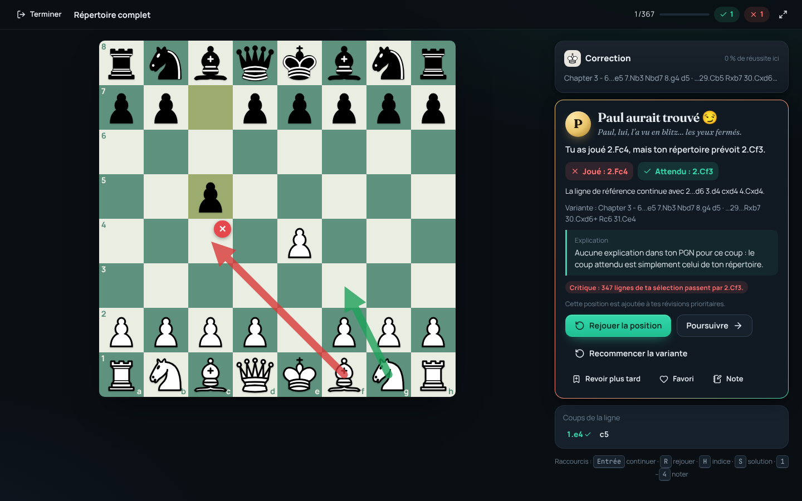
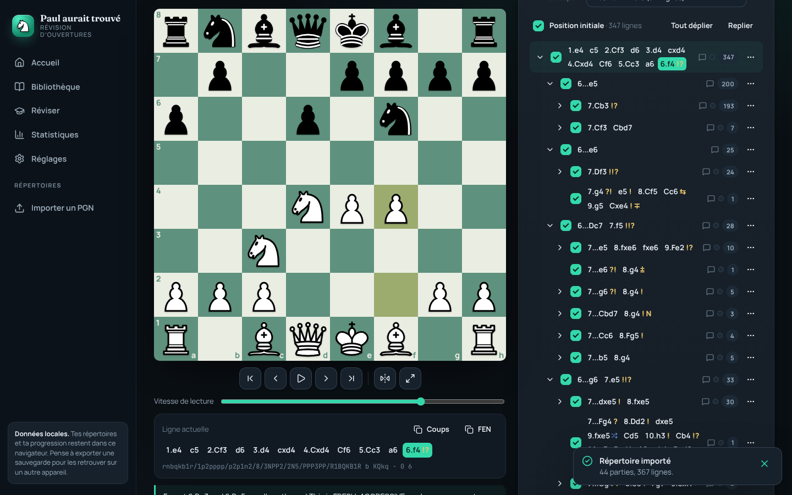
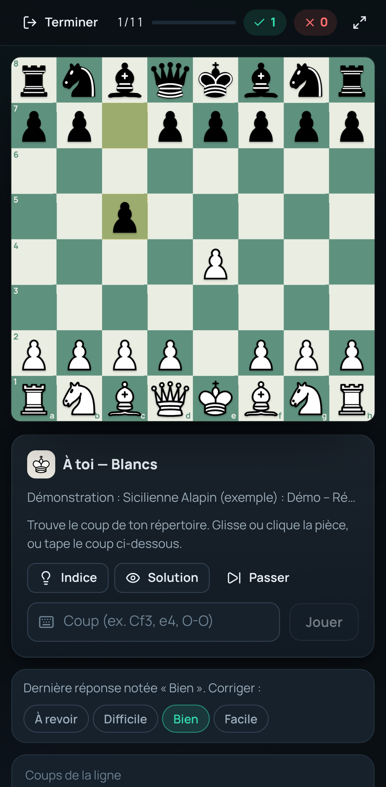

# Paul aurait trouvé — révision d’ouvertures d’échecs

Application de révision d’ouvertures à partir de **tes propres fichiers PGN** : import fidèle (variantes imbriquées, commentaires, NAG, flèches, positions FEN), sélection précise des variantes, révision interactive sur l’échiquier, répétition espacée **FSRS**, statistiques réelles, éditeur PGN, analyse Stockfish facultative. Fonctionne dans le navigateur (PWA installable, hors ligne) et sous forme d’**APK Android** (Capacitor).

Quand tu joues un coup absent de ton répertoire : **« Paul aurait trouvé »**, avec le coup attendu, la ligne de référence, la variante, l’explication du PGN quand elle existe et la gravité de l’erreur.

| Révision | Explorateur | Mobile |
| --- | --- | --- |
|  |  |  |

---

## Démarrage rapide

Prérequis : **Node.js 22** et npm.

```bash
npm ci            # installe les dépendances
npm run dev       # http://localhost:5173
```

Puis : **Importer un PGN** → glisse ton fichier → **Importer** → **Réviser la sélection**.

| Commande | Rôle |
| --- | --- |
| `npm run dev` | serveur de développement |
| `npm run build` | vérification TypeScript + build de production dans `dist/` |
| `npm run preview` | sert `dist/` avec les mêmes en-têtes de sécurité que Netlify (http://localhost:4173) |
| `npm test` | tests unitaires (Vitest) |
| `npm run test:e2e` | tests de bout en bout (Playwright, sur le build de production) |
| `npm run audit:pgn` | audit des fichiers `.pgn` du dépôt (lecture, encodage, légalité des coups) |
| `npm run icons` | régénère les icônes PWA/Android depuis `public/icon.svg` |
| `npm run android:apk` | build web + synchronisation Capacitor + APK de débogage |

---

## Utilisation

### 1. Importer ton PGN
Menu **Importer un PGN** :
- **Fichiers** : un ou plusieurs `.pgn` (glisser-déposer accepté). UTF-8, avec repli Windows-1252 pour les anciens fichiers.
- **Coller** : un texte PGN.
- **GitHub** : `propriétaire/dépôt` (ou l’URL d’un fichier). Le dépôt `pccp8556/Echecs` est proposé par défaut ; la liste des `.pgn` s’affiche, tu choisis lesquels importer.
- **Adresse web** : une URL brute (le serveur doit autoriser CORS).

Avant l’import, un **rapport** indique parties, coups, positions, lignes, variantes, commentaires, flèches, coups invalides, erreurs (partie, ligne, numéro de coup) et le camp détecté (modifiable). Rien n’est jamais supprimé : une variante illisible est conservée telle quelle et exclue des révisions.

### 2. Sélectionner une variante
Ouvre le répertoire (**Explorer**). L’arbre fusionne tous les chapitres : coche/décoche une branche, une sous-variante, ou passe par **Chapitres**, **Lignes** ou **Graphe**. Le bandeau indique le nombre de lignes et de positions sélectionnées. **Rien** puis une case = « seulement cette variante ». **Enregistrer** garde la sélection comme session réutilisable. Les coups qui mènent à la sélection sont joués automatiquement, jamais demandés (sauf option).

### 3. Lancer une session
**Réviser la sélection** (ou **Commencer ma révision** sur l’accueil) : choisis un préréglage ou un mode, la couleur, le nombre de positions, la durée, les aides et la politique d’erreur.

Modes : révision intelligente (FSRS), apprentissage guidé, à l’aveugle, répertoire complet, coups critiques, erreurs, contre une ligne (couleurs inversables), entraînement libre, chronométré, parcours progressif, exploration.

Pendant la révision : glisser-déposer ou clic-clic (souris et tactile), saisie du coup au clavier (`Cf3` ou `Nf3`), indice, solution, rejouer, poursuivre, recommencer la variante, revoir plus tard, favori, note. Raccourcis : `Entrée` continuer, `R` rejouer, `H` indice, `S` solution, `1`–`4` noter.

### 4. Modifier ton répertoire
**Éditer** : mode visuel (joue un coup pour ajouter une variante, commentaires, NAG, promotion/suppression de variantes, en-têtes) ou mode texte (PGN de la partie ou de tout le répertoire, validé avant application, avec alerte si des coups/commentaires disparaissent). Annuler/rétablir (`Ctrl+Z` / `Ctrl+Y`).

### 5. Sauvegarder tes changements
**Enregistrer** dans l’éditeur : la version précédente est conservée dans l’**Historique** (25 versions, restaurables). **Exporter** produit un PGN valide ; une partie non modifiée est exportée à l’identique de l’original, et tes marques/notes personnelles sont ajoutées en commentaires (`[%patmark …]`, « Note perso : … »), relues à la réimportation.

### 6. Retrouver ta progression
Tout est enregistré automatiquement dans le navigateur (IndexedDB) : répertoires, progression FSRS, journal des réponses, sessions (une session interrompue se **reprend** depuis l’accueil). **Réglages → Données** : exporter / restaurer une sauvegarde complète (JSON). Les données d’un navigateur ne sont **pas synchronisées** avec un autre appareil : exporte la sauvegarde puis restaure-la ailleurs.

---

## Déploiement sur Netlify

Le dépôt contient `netlify.toml` (build `npm run build`, publication `dist/`, redirection SPA `/* → /index.html`, en-têtes de sécurité dont une CSP compatible WebAssembly, cache long des ressources).

**Méthode recommandée (aucun secret à gérer)** :
1. Sur https://app.netlify.com : *Add new site → Import an existing project → GitHub* et choisis `pccp8556/Echecs`.
2. Netlify lit `netlify.toml` : laisse les champs par défaut et clique *Deploy*.
3. Chaque branche ou pull request obtient une **URL de prévisualisation** (*Deploy Previews / Branch deploys* à activer dans *Site configuration → Build & deploy*).

**Alternative sans compte relié** : `npm run build`, puis glisse le dossier `dist/` sur https://app.netlify.com/drop.

**Alternative par GitHub Actions** (`.github/workflows/netlify.yml`) : ajoute les secrets `NETLIFY_AUTH_TOKEN` et `NETLIFY_SITE_ID` dans *Settings → Secrets and variables → Actions* du dépôt ; sans ces secrets le workflow ne fait rien.

**Variables d’environnement** (toutes publiques, aucune n’est un secret) :
- `VITE_DEFAULT_GITHUB_REPO` : dépôt proposé par défaut dans l’import GitHub (`pccp8556/Echecs`).
- `VITE_APP_VERSION` : numéro de version affiché (facultatif).

**Tester en production** : ouvre l’URL, importe ton PGN, lance une session ; *Réglages → À propos* affiche la version. Hors ligne : après une première visite, l’application se recharge sans réseau (bandeau « Prête pour le hors-ligne »).

> Confidentialité : le build ne contient **aucun** fichier PGN (vérifié par `tests/deploy.test.ts`). Ton PGN reste dans ton navigateur après import. Le fichier présent à la racine du dépôt est public tant que le dépôt l’est.

---

## Android

Projet Capacitor dans `android/` (paquet `io.github.pccp8556.paulauraittrouve`, Android 7 minimum, cible Android 16). Détails, signature et Play Store : **[docs/ANDROID.md](docs/ANDROID.md)**.

```bash
# Prérequis : JDK 21, Android SDK (platforms;android-36, build-tools;36.0.0), ANDROID_HOME défini
npm run android:apk
# → android/app/build/outputs/apk/debug/app-debug.apk
```

Le workflow `.github/workflows/android.yml` construit l’APK de débogage à chaque push et le publie comme artefact téléchargeable dans l’onglet *Actions*.

---

## GitHub et fichiers PGN

| Cas | Solution |
| --- | --- |
| PGN dans ce dépôt | Onglet **GitHub** de l’import, dépôt prérempli ; ou fichier local. |
| Autre dépôt **public** | `propriétaire/dépôt` ou URL `github.com/…/blob/…/fichier.pgn` (API GitHub, 60 requêtes/heure, repli sur raw.githubusercontent.com). |
| Dépôt **privé** | Jeton *fine-grained* GitHub limité au dépôt, permission **Contents: Read-only**, saisi dans *Réglages → GitHub*. Il reste sur l’appareil (oublié à la fermeture par défaut), n’est envoyé qu’à `api.github.com`, jamais exporté. |

**Recharger depuis la source** compare le SHA Git (ou l’empreinte du contenu), montre les différences et signale un **conflit** si tu as modifié le répertoire dans l’application ; rien n’est remplacé sans confirmation et l’ancienne version reste dans l’historique. L’**écriture vers GitHub n’est pas implémentée** : exporte le PGN puis pousse-le toi-même.

---

## Tests

- **73 tests unitaires** (`npm test`) : import PGN (simple, multiple, variantes imbriquées, commentaires, NAG, métadonnées, FEN, invalide, vide, 2 000 parties, caractères inhabituels, aller-retour sans perte sur le PGN réel), moteur de révision (coup conforme, légal hors répertoire, illégal, alternative, variante non sélectionnée, transpositions, Blancs, Noirs, FEN, erreur puis correction…), FSRS, statistiques, stockage IndexedDB (enregistrement, rechargement, modification, suppression, export, restauration), configuration Netlify et contenu du build.
- **10 tests de bout en bout** (`npm run test:e2e`, Chromium, build de production avec CSP) : routes SPA, navigation, import du PGN réel, sélection d’une sous-variante, validation des coups, « Paul aurait trouvé », reprise de session, statistiques, éditeur + export, manifeste/service worker/Stockfish, mobile tactile.

---

## Architecture et choix techniques

React 19 + TypeScript + Vite, état avec Zustand, routage React Router. Détails : **[docs/ARCHITECTURE.md](docs/ARCHITECTURE.md)**.

- **chess.js** (BSD-2) pour la légalité des coups ; **@mliebelt/pgn-parser** (Apache-2.0) pour la syntaxe PGN, entouré d’une couche tolérante (découpage des parties, roques `0-0`, lignes `%`, erreurs localisées, coups illégaux conservés).
- **ts-fsrs** (MIT) pour la répétition espacée.
- **Échiquier maison** (Pointer Events) : glisser-déposer souris/tactile, clic-clic, promotion, flèches, clavier, animations ; chessground a été écarté (GPL-3.0 imposée à toute l’application).
- **IndexedDB** (idb) pour les données, `localStorage` uniquement pour les préférences.
- **Stockfish 18 lite** (WebAssembly mono-thread, GPL-3.0) chargé à la demande dans un Web Worker, sans en-têtes COOP/COEP.

## Licences et crédits

Aucune licence n’est encore choisie pour le code de l’application (au propriétaire du dépôt de décider). Composants tiers : chess.js (BSD-2-Clause), @mliebelt/pgn-parser (Apache-2.0), ts-fsrs (MIT), React (MIT), Lucide (ISC), polices Fraunces/Manrope/JetBrains Mono (OFL). **Stockfish** : GPL-3.0, fichiers et licence dans `public/stockfish/` (source : https://github.com/nmrugg/stockfish.js). **Pièces** : « Cburnett » (CC BY-SA 3.0) et « Staunty » (CC BY-NC-SA 4.0, usage non commercial), via cm-chessboard.
